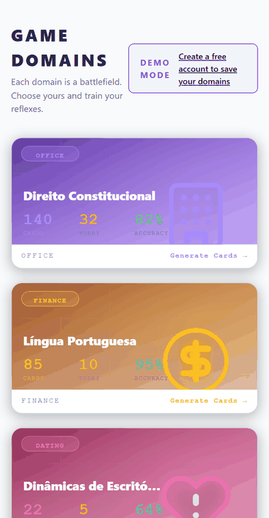

# OmniFlash (Klique API)

[🇧🇷 Português](#) | [🇺🇸 English](./README.en.md) | [🇪🇸 Español](./README.es.md)

<p align="center">
  
</p>

Plataforma fullstack de flashcards táticos baseada em Teoria dos Jogos e Repetição Espaçada (SRS). O sistema modela cenários de tomada de decisão para estudantes e concurseiros através de um motor de inferência estratégica e geração procedural de imagens.

[](https://fastapi.tiangolo.com/)
[](https://react.dev)
[](https://mongodb.com)
[](https://docker.com)
[](https://tailwindcss.com)

---

## Arquitetura do Sistema

O sistema é dividido em cinco subsistemas integrados por eventos e chamadas assíncronas:

| Subsistema | Componentes Principais | Função Técnica |
| :--- | :--- | :--- |
| **Backend REST** | FastAPI, Motor (AsyncIO), Pydantic v2 | Gerencia autenticação JWT/Passkey, domínios, cards e transações financeiras. |
| **Motor SRS** | SuperMemo-2 (`_apply_sm2`), MongoDB | Calcula intervalos de revisão, fatores de facilidade (EF) e agenda cards vencidos. |
| **Agente Cognitivo** | LangGraph, `MemorySaver`, MultiServerMCP | Executa raciocínio analítico com isolamento de contexto por usuário (`thread_id`). |
| **Síntese Visual** | Gemini WebAPI, Async Semaphore, Pillow | Gera ilustrações procedurais 3D sem texto ou marcas d'água com cache em disco e banco. |
| **Frontend Reativo** | React 19, Vite, Tailwind v4, Capacitor 6 | Interface mobile-first com animações táteis de swipe, gráficos e suporte PWA/Android. |

---

## Algoritmo de Repetição Espaçada (SM-2)

As revisões utilizam a formulação clássica do algoritmo SuperMemo-2 adaptada para execução assíncrona:

$$I(n) = \begin{cases} 1 & \text{se } q < 3 \\ 1 & \text{se } q \ge 3 \text{ e } n = 0 \\ 6 & \text{se } q \ge 3 \text{ e } n = 1 \\ \text{round}(I \times EF) & \text{se } q \ge 3 \text{ e } n \ge 2 \end{cases}$$

$$EF' = \max\left(1.3, \; EF + 0.1 - (5 - q) \times (0.08 + (5 - q) \times 0.02)\right)$$

- **Escala de Avaliação ($q$)**: De 0 (falha total) a 5 (recordação perfeita).
- **Fator de Facilidade ($EF$)**: Inicializado em 2.5 com piso restrito a 1.3.
- **Armazenamento**: Histórico registrado na coleção `simulation_logs` e agendamentos atualizados na coleção `reviews`.

---

## Estrutura do Repositório

```text
klique-api/
├── app/                        # Núcleo da API assíncrona (FastAPI + Python 3.12+)
│   ├── main.py                 # Ponto de entrada, ciclo de vida (lifespan) e middlewares
│   ├── config.py               # Variáveis de ambiente e constantes operacionais
│   ├── database.py             # Pools de conexão assíncronos MongoDB (Motor)
│   ├── scheduler.py            # Agendamento de rotinas em segundo plano (APScheduler)
│   ├── agents/                 # Agente LangGraph, checkpointer e cliente MultiServerMCP
│   ├── routers/                # Rotas da API (auth, cards, srs, payments, credits, whatsapp)
│   └── services/               # Clientes de integração (Mercado Pago, WhatsApp, Gemini)
├── frontend/                   # Aplicação cliente (React 19 + Vite + Tailwind v4)
│   ├── src/pages/              # Telas (CardSwipePage, TrainingPage, DashboardPage, DomainsPage)
│   ├── src/components/         # Componentes modulares de interface e cards de cenário
│   └── src/context/            # Contextos globais de autenticação, tema e idioma
├── docs/                       # Demonstrações visuais, esquemas de arquitetura e documentação
├── scripts/                    # Automações de administração, gravação e geração de mídia
└── pyproject.toml              # Definições de dependências gerenciadas via uv
```

---

## Instalação e Execução

### Requisitos Prévios
- Python 3.12+ com gerenciador `uv`
- Node.js 20+ e npm
- Instância do MongoDB em execução (local ou via Docker)

### 1. Backend
```bash
# Sincronizar dependências
uv sync

# Inicializar o servidor da API
uv run task run
```
A API responde por padrão em `http://localhost:8000`. A documentação interativa OpenAPI está disponível em `/docs`.

### 2. Frontend
```bash
cd frontend

# Instalar dependências
npm install

# Inicializar o servidor de desenvolvimento
npm run dev
```
A interface web responde por padrão em `http://localhost:5173`.

---

## Documentação Arquitetural e Grafo de Conhecimento

O repositório possui uma base de conhecimento estruturada gerada pelo Graphify no diretório `graphify-out/`:
- **[Relatório Arquitetural (GRAPH_REPORT.md)](./graphify-out/GRAPH_REPORT.md)**: Auditoria completa de métricas de acoplamento, nós centrais e conexões.
- **[Wiki de Engenharia](./graphify-out/wiki/index.md)**: 122 artigos detalhando módulos, com análises aprofundadas dos subsistemas de [WhatsAppService](./graphify-out/wiki/WhatsAppService.md), [Agentes de IA e Síntese Visual](./graphify-out/wiki/AI_Agents_&_Image_Generation.md), [Repetição Espaçada SM-2](./graphify-out/wiki/SRS_Spaced_Repetition_&_Gamification.md) e [Economia e Pagamentos PIX](./graphify-out/wiki/Internal_Economy_&_PIX_Payments.md).
- **[Grafo Interativo (HTML)](./graphify-out/graph.html)**: Visualizador web dos 1.446 nós e 2.882 arestas do sistema.

---

## Licença

MIT License. Consulte o arquivo [LICENSE](./LICENSE) para detalhes completos.
