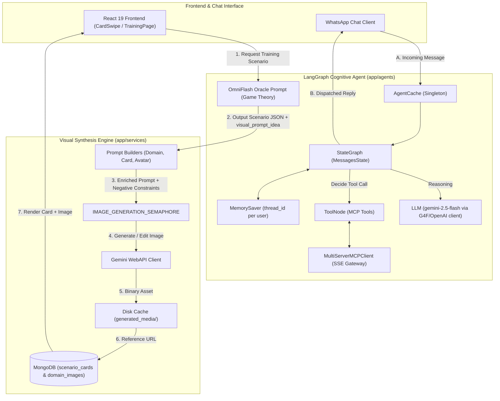

# AI Agents & Image Generation Pipeline — Architectural Deep Dive

> **Core Cognitive Engine** · LangGraph + Multi-Server MCP + Gemini WebAPI Image Synthesizer  
> **Source Files:** `app/agents/agent.py`, `app/agents/tasks.py`, `app/services/image_generation.py`, `app/agents/omniflash_oracle_prompt.md`  
> **Communities:** [AI Oracle & Intelligent Agents](AI_Oracle_&_Intelligent_Agents.md), [Image Generation & Prompts](Image_Generation_&_Prompts.md), [Data Models & DTO Schemas](Data_Models_&_DTO_Schemas.md)

---

## 🏛️ Executive Summary: The Cognitive & Visual Loop

The OmniFlash platform uses Artificial Intelligence not as a passive chat interface, but as a proactive simulation and gamification engine. It pairs **Game Theory analysis** with **high-craft procedural image generation** to train users' cognitive and strategic reflexes.

The subsystem consists of two tightly coupled engines:
1. **LangGraph Agent Engine (`app/agents/agent.py`)**:
   - Stateful agent built on LangGraph's `StateGraph(MessagesState)`.
   - In-memory conversation checkpointing with `MemorySaver()`, isolated per user via `thread_id` (e.g. user phone number).
   - Extensible Tool Integration via `MultiServerMCPClient` connecting to Dockerized MCP gateways (WhatsApp, Sigaa, Social).
   - Automatic message trimming (`trim_messages`) with a 2,000 token sliding window.
2. **Gemini Visual Synthesizer (`app/services/image_generation.py`)**:
   - Concurrency-controlled worker with `asyncio.Semaphore(GEMINI_CONCURRENCY_LIMIT)`.
   - Opinionated artistic direction (cinematic 3D editorial, studio lighting, zero typography/watermarks).
   - Multilevel caching (local filesystem `generated_media/` + MongoDB `domain_images_collection` and `scenario_cards_collection`).
   - Image refinement and editing capabilities via Gemini image-to-image prompts.

---

## 🔄 End-to-End Pipeline Architecture



---

## 🧠 The LangGraph Agent Architecture (`app/agents/`)

### 1. Singleton Lifecycle (`AgentCache`)
To prevent expensive graph recompilation and retain conversation state across HTTP and webhook requests, `AgentCache` stores:
- Compiled `StateGraph` instance (`cls._agent`)
- Persistent checkpoint instance (`cls._checkpointer = MemorySaver()`)

Resetting can be triggered at runtime via `reset_agent_cache()` for zero-downtime tool reloads or debugging.

### 2. Multi-Server MCP Integration
The agent connects via Server-Sent Events (SSE) to an external MCP gateway:
```python
client = MultiServerMCPClient({
    'MCP_GATEWAY': {
        'url': 'http://host.docker.internal:8020',
        'transport': 'sse',
        'headers': {'Authorization': 'Bearer ...'},
    }
})
tools = await client.get_tools()
```
This enables the agent to dynamically inspect external systems, dispatch social posts (Instagram, LinkedIn, WhatsApp Status), or interact with external academic APIs (Sigaa).

### 3. Context Optimization & Sliding Window
To prevent unbounded memory growth, `call_model` executes `trim_messages()`:
- Max tokens: 2,000 tokens
- Strategy: Keep latest interactions, starting on human query, ending on human/tool response
- Invariant: Injects `system_instrutions.md` at index 0 if not present.

---

## 🎨 The Visual Synthesis Engine (`app/services/image_generation.py`)

### 1. Opinionated Aesthetic Constraints
Every image request automatically appends `IMAGE_NEGATIVE_PROMPT`:
> *"Sem texto, sem tipografia, sem legendas, sem watermark, sem interface, sem colagens, sem múltiplos painéis."*

### 2. Specialized Prompt Builders
- **Domain Cards (`build_domain_image_prompt`)**: 3D editorial illustration, clean composition, central thematic symbol, dramatic studio lighting, conveying power and strategy.
- **Scenario Cards (`build_card_image_prompt`)**: Translates `visual_prompt_idea` from the Game Theory Oracle into a high-stakes, photorealistic dramatic scene highlighting context and tension.
- **User Avatars (`build_avatar_image_prompt`)**: Clean studio bust portrait, high definition, natural facial expression.
- **Style Refinement (`build_style_improvement_prompt`)**: Preserves scene identity while enhancing lighting, contrast, and materials.

### 3. Concurrency & Dual-Tier Caching
- **Concurrency Gate**: Bound by `IMAGE_GENERATION_SEMAPHORE` (`GEMINI_CONCURRENCY_LIMIT`) to protect against rate limits and CPU starvation.
- **Filesystem Cache**: Fast local file check in `generated_media/{output_dir}/{base_name}.png`.
- **Database Cache**: Themes and card visual associations are stored in MongoDB, allowing identical domain themes to be shared across all users instantly without re-generating.

---

## 🔗 Cross-System Synergy: The Oracle ↔ SRS ↔ Social Loop

1. **Card Generation**:
   The user opens the training interface. The backend runs `generate_card_stream()` (`app/routers/cards.py`), invoking the Oracle prompt to construct a game theory dilemma (Nash equilibrium, Prisoner's dilemma, payoff matrix).
2. **Visual Synthesis**:
   The Oracle's `visual_prompt_idea` is concurrently fed into `get_or_generate_card_image()`. The image is generated in the background and streamed or saved alongside the card.
3. **SRS Spaced Repetition**:
   The user reviews the card on `CardSwipePage` (`frontend/src/pages/CardSwipePage.jsx`). Submitting their answer calls `_apply_sm2()` to update card intervals, difficulty, and next review date.
4. **Social Amplification (Viral Hook)**:
   High-heat scenarios can be exported to WhatsApp status via `app/agents/tasks.py`. When contacts view the status, `process_status_viewed_for_image_generation()` triggers a fresh visual synthesis cycle, completing the viral loop!

---

*Part of the OmniFlash Knowledge Graph & Wiki. Back to [index](index.md).*
