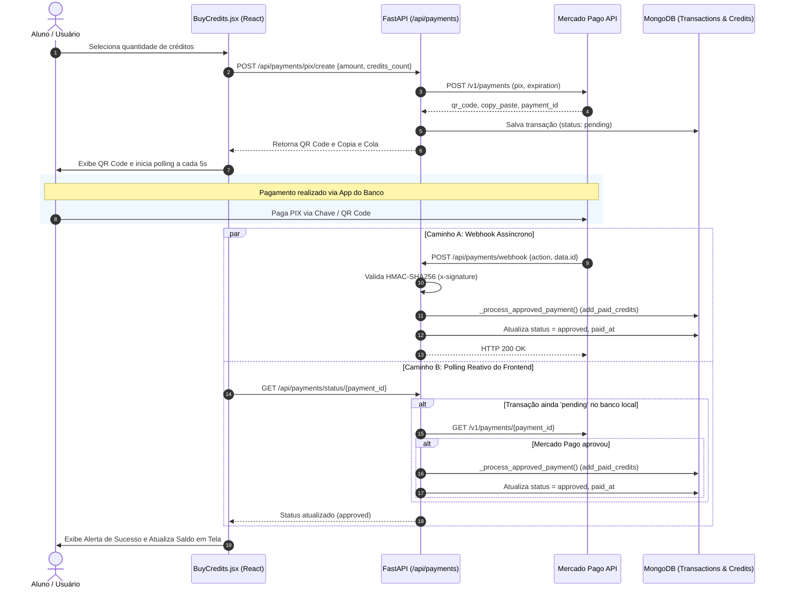

# Internal Economy, Credits & PIX Payments (Mercado Pago)

> **Monetization & Virtual Economy Engine** · Real-Time PIX + Dual-Path Verification + Atomic Credits Ledger  
> **Source Files:** `app/routers/payments.py`, `app/routers/credits.py`, `app/services/mercadopago.py`, `frontend/src/components/Payment/BuyCredits.jsx`  
> **Communities:** [Billing & PIX Payments](Billing_&_PIX_Payments.md), [Data Models & DTO Schemas](Data_Models_&_DTO_Schemas.md), [Authentication & Tokens](Authentication_&_Tokens.md)

---

## 🏛️ Executive Summary: The Economy Engine

OmniFlash (`klique-api`) operates on an internal virtual credits economy to regulate high-compute Artificial Intelligence operations (such as Game Theory scenario generation and Gemini image synthesis) while providing frictionless micro-transactions via **PIX (Brazilian Instant Payment System)**.

Key Architectural Highlights:
1. **Dual Verification Architecture**: Credits are granted via either incoming Mercado Pago Webhooks or active client status polling, guaranteeing zero lost payments even under network failure or webhook delivery delays.
2. **Idempotent Credits Ledger**: Protects against double-crediting by verifying transaction state before releasing paid credits in MongoDB.
3. **Tiered Consumption Priority**: Users spend `free_credits` first before consuming `paid_credits`.
4. **Reactive Frontend Checkout**: Real-time QR Code rendering, one-click Copia-e-Cola clipboard integration, and background polling every 5 seconds with automatic state refresh.

---

## 🔄 Dual-Path Payment & Settlement Flow



---

## 🪙 Estrutura de Créditos & Ledger (`app/routers/credits.py`)

### 1. Concessão Inicial (`FREE_CREDITS_PER_USER`)
Ao se registrar ou efetuar a primeira ação, o usuário recebe um registro inicial na coleção `user_credits_collection`:
- `free_credits`: Cota gratuita inicial para onboarding e testes da plataforma.
- `paid_credits`: 0.
- `total_generated`: Contador cumulativo de cards gerados.

### 2. Prioridade de Consumo Atômico (`use_one_credit`)
A geração de cartas e imagens invoca `use_one_credit(user_id)`:
```python
# Consome crédito gratuito prioritariamente
if free > 0:
    update_field = 'free_credits'
else:
    update_field = 'paid_credits'

await db_credits.update_one(
    {'user_id': user_id, update_field: {'$gt': 0}},
    {
        '$inc': {update_field: -1, 'total_generated': 1},
        '$set': {'updated_at': now}
    }
)
```
Essa operação é atômica no MongoDB, prevenindo condições de corrida (*race conditions*) caso o usuário dispare múltiplas gerações simultâneas.

### 3. Liberação Segura de Créditos (`add_paid_credits`)
Quando o pagamento é confirmado, `add_paid_credits(user_id, amount)` incrementa `paid_credits` e cria um registro no extrato de auditoria.

---

## 💳 Integração Mercado Pago (`app/services/mercadopago.py`)

- **Autenticação**: Bearer token via `MP_ACCESS_TOKEN`.
- **Validação Criptográfica de Webhook**:
  - `verify_webhook_signature(x_signature, x_request_id, data_id)`:
  - Extrai `ts` e `v1` do cabeçalho `x-signature`.
  - Computa `hmac.new(MP_WEBHOOK_SECRET, manifest, hashlib.sha256)`.
  - Valida se a assinatura bate com `v1`, mitigando ataques de falsificação de notificação (*webhook spoofing*).
- **Tempo de Expiração**: Pix gerado com validade de 30 minutos (`expiration_date`).

---

## 📱 Componentes Frontend (`frontend/src/components/Payment/`)

1. **`BuyCredits.jsx`**:
   - Seletor de valor unitário e quantidade respeitando limites do backend (`min_price_per_credit`, `min_quantity`).
   - Copia e cola com feedback visual e cópia direta para o clipboard (`navigator.clipboard.writeText`).
   - Loop reativo de polling via `setInterval(checkStatus, 5000)`, com destruição limpa do timer no unmount (`clearInterval`).
   - Atualização automática do estado global de créditos chamando `refreshCredits()` do `AuthContext`.
2. **`PaymentModal.jsx`**:
   - Modal promocional de conversão exibindo benefícios premium: imagens em alta resolução, remoção de marca d'água e compartilhamento social.

---

*Part of the OmniFlash Knowledge Graph & Wiki. Back to [index](index.md).*
