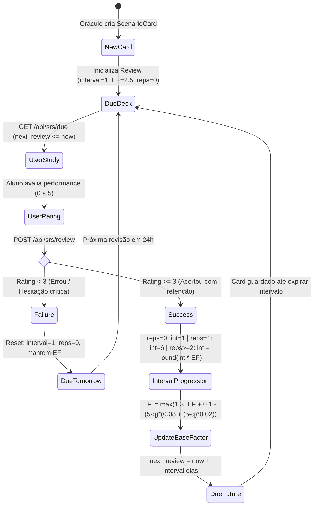

# Spaced Repetition Engine (SRS / SM-2) & Gamification Pipeline

> **Core Learning & Retention Architecture** · SuperMemo-2 Algorithm + Reactive Flashcard UI  
> **Source Files:** `app/routers/srs.py`, `app/schemas.py`, `frontend/src/pages/TrainingPage.jsx`, `frontend/src/pages/CardSwipePage.jsx`  
> **Communities:** [Flashcard Review & Training UI](Flashcard_Review_&_Training_UI.md), [Data Models & DTO Schemas](Data_Models_&_DTO_Schemas.md), [Flashcards Generation & SRS](Flashcards_Generation_&_SRS.md)

---

## 🏛️ Executive Summary: The Memory & Reflex Architecture

In OmniFlash (`klique-api`), flashcards are not static Q&A pairs; they are **tactical scenario simulations** rooted in Game Theory, civil service exams (*concursos*), and behavioral strategy.

To ensure long-term retention without cognitive overload, OmniFlash integrates an asynchronous implementation of the **SuperMemo-2 (SM-2)** algorithm. The backend calculates dynamic spacing intervals and difficulty factors based on user performance (scale 0–5), while the React 19 frontend provides tactile review mechanics, streak tracking, and visual heat feedback.

---

## 🔄 SRS State Machine & Review Lifecycle



---

## 📐 Mathematical Formulation of SuperMemo-2 (`app/routers/srs.py`)

The SM-2 implementation operates on 4 variables:
- **$I$ (Interval)**: Days until the next review.
- **$EF$ (Ease Factor)**: Multiplier reflecting card complexity (default: `2.5`, floor: `1.3`).
- **$n$ (Repetitions)**: Number of consecutive successful recalls ($q \ge 3$).
- **$q$ (Quality / Rating)**: User performance score from 0 to 5.

### 1. Performance Scale (0 to 5)
- **5 (Verde #22c55e)**: Resposta perfeita sem hesitação.
- **4 (Verde Claro #84cc16)**: Resposta correta com hesitação leve.
- **3 (Amarelo #eab308)**: Resposta correta com esforço/dificuldade significativa.
- **2 (Laranja Claro #f59e0b)**: Incorreta, mas a resposta certa parecia óbvia ao ser revelada.
- **1 (Laranja #f97316)**: Incorreta, lembrada vagamente após revelação.
- **0 (Vermelho #ef4444)**: Falha total (blackout cognitivo).

### 2. Interval Progression Logic
$$
I(n) = \begin{cases} 
1 & \text{se } q < 3 \text{ (falha)} \\
1 & \text{se } q \ge 3 \text{ e } n = 0 \\
6 & \text{se } q \ge 3 \text{ e } n = 1 \\
\text{round}(I \times EF) & \text{se } q \ge 3 \text{ e } n \ge 2 
\end{cases}
$$

### 3. Dynamic Ease Factor Adjustment
$$
EF' = \max\left(1.3, \; EF + \left(0.1 - (5 - q) \times (0.08 + (5 - q) \times 0.02)\right)\right)
$$
- If the student scores a perfect 5: $EF' = EF + 0.1$ (card becomes progressively more spaced).
- If the student scores a 3: $EF' = EF - 0.14$ (card becomes harder and repeats more frequently).

---

## 📡 API Contract & Persistence (`/api/srs`)

### 1. `GET /api/srs/due`
- Authenticated via `get_current_active_user`.
- Filters MongoDB `reviews_collection` for `{'user_id': user_id, 'next_review_date': {'$lte': now}}`.
- Joins with `scenario_cards_collection`, returning a sorted list of `DueCard(card: ScenarioCard, review: Review)`.

### 2. `POST /api/srs/review`
- Body: `ReviewSubmitRequest(card_id: str, performance_rating: int)` (0–5).
- Calculates `new_interval`, `new_ef`, and `new_reps` using `_apply_sm2`.
- Persists new state into `reviews_collection` and logs telemetry into `simulation_logs_collection`:
  ```json
  {
    "user_id": "...",
    "card_id": "...",
    "domain_id": "...",
    "performance_rating": 4,
    "reviewed_at": "2026-11-07T13:52:00Z"
  }
  ```

### 3. `GET /api/srs/stats`
- Computes aggregated user metrics:
  - `total_trained`: Total simulation logs recorded.
  - `streak_days`: Consecutive days with at least one review.
  - `cards_mastered`: Cards with `interval >= 21` days.
  - `retention_rate`: Percentage of reviews with rating $\ge 3$.

---

## 🎮 Frontend Gamification & UX (`frontend/src/`)

### 1. Tactile Training Experience (`TrainingPage.jsx`)
- **Rating Bar**: 6 discrete, color-coded tactile buttons mapped to SM-2 ratings.
- **Dynamic Progress**: Visual bar reflecting $(currentIndex / totalDue) \times 100$.
- **Celebration & Mastery Summary**: Screen featuring `IconSparkBoost`, displaying cards reviewed, daily streak, and mastered cards counter.

### 2. Multi-Format Scenario Cards (`CardSwipePage.jsx`)
- Supports multiple card representations:
  - `GameTheoryCard`: If-Then, Payoff Matrix, Black Swan with probability heat score (0–100).
  - `ConcursoCard`: Format Cespe/Cebraspe (Certo/Errado) and FCC/FGV (Multiple Choice).
  - `FlashcardBasic`: Traditional front/back flashcard.
- Dynamic Theme Styling: Custom SVG domain badges (`DomainSVGCard`) and heat gradients (`TEMPLATE_COLORS`).

---

*Part of the OmniFlash Knowledge Graph & Wiki. Back to [index](index.md).*
