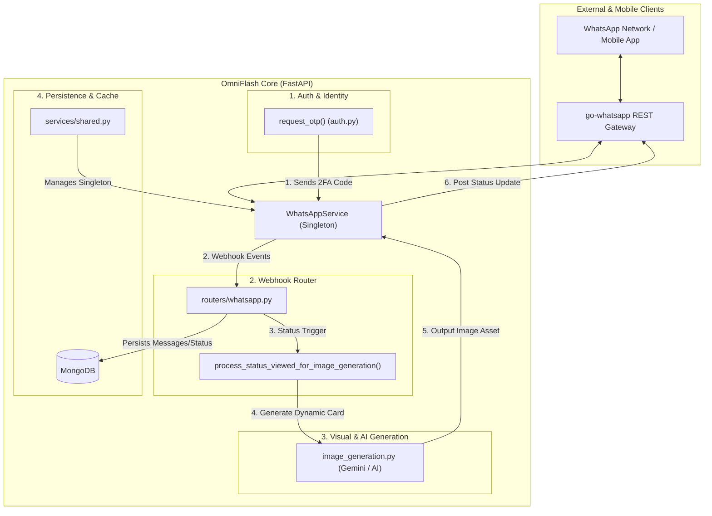

# WhatsAppService — Architectural Deep Dive & Cross-Boundary Bridge

> **God Node** · 56 direct connections · Core Architectural Bridge  
> **Source:** `app/services/whatsapp.py:L34`  
> **Community:** [WhatsApp Integration Service](WhatsApp_Integration_Service.md)

---

## 🏛️ Executive Summary: Why WhatsAppService is a God Node

In OmniFlash (`klique-api`), `WhatsAppService` is not merely a utility wrapper around the external `go-whatsapp` REST API; it functions as the central communication, authentication, and proactive engagement bus of the entire platform.

Because OmniFlash blends gamified flashcards (SRS), game theory mechanics, and social interaction loops, WhatsApp is treated as a first-class user interface layer. Consequently, `WhatsAppService` acts as a **cross-boundary bridge** across 4 critical domains:

1. **Authentication & Identity (`app/routers/auth.py`)**: One-Time Password (OTP) dispatch for passwordless login and verification.
2. **Dynamic Visual Generation (`app/services/image_generation.py`)**: Automated triggers where WhatsApp status interactions generate customized AI avatars and scenario illustrations.
3. **Reactive Webhook Engine (`app/routers/whatsapp.py`)**: Ingestion and dispatch of messages, media downloads, reactions, group tracking, and status lifecycle events.
4. **Shared Dependency Injection (`app/services/shared.py`)**: Global singleton orchestration reused across synchronous routes and asynchronous background workers.

---

## 🔄 Cross-Boundary Flow Diagram

---

## 🧩 The 4 Cross-Boundary Pillars

### 1. Authentication & Security Bridge
- **Caller:** `app/routers/auth.py` (`request_otp()`, L338)
- **Role:** Generates access codes, saves an expiring record into MongoDB's OTP collection, and dispatches an immediate text payload via `ws.send_message(f'{phone}@s.whatsapp.net', code)`.
- **Architectural Impact:** Couples authentication flow availability to external messaging uptime.

### 2. Proactive Viral Loop & Image Generation
- **Caller:** `app/routers/whatsapp.py` (`process_status_viewed_for_image_generation()`, L296)
- **Role:** When a viewer watches an OmniFlash WhatsApp status, a webhook fires. The system queries `whatsapp_service.get_contact_info(user_number)`, retrieves their avatar/pushname, calls `image_generation_service` to synthesize a contextual study scenario card, and uploads the new graphic as an updated status.
- **Architectural Impact:** WhatsApp acts as an automated, bidirectional retention and marketing funnel.

### 3. Comprehensive Messaging & Lifecycle Protocol
- **Methods:** 38 distinct operations implemented in `app/services/whatsapp.py`:
  - **Status Lifecycle:** `.post_status_update()`, `.get_statuses()`, `.status_exists()`, `.delete_status()`, `.get_latest_status_id()`
  - **Rich Messaging:** `.send_message()`, `.send_image_message()`, `.send_link()`, `.send_location()`, `.react_message()`
  - **Media & Groups:** `.download_media()`, `.get_contact_avatar()`, `.create_group()`, `.add_group_participants()`

### 4. Enterprise Testing Rigor
- **Test Suite:** `tests/test_status_deletion.py`
- Extensive coverage of edge cases: non-existent status deletion (`test_delete_nonexistent_status`), existence verification (`test_status_existence_check`), and detailed payload audits (`test_status_deletion_detailed`).

---

## 🛠️ Architectural Recommendations

While `WhatsAppService` is robust, its high betweenness centrality (God Node status) indicates architectural risks:

1. **Decouple via Message Queue / Event Bus**:
   - *Current:* Webhook endpoints directly await `WhatsAppService` and trigger compute-heavy image generation tasks.
   - *Recommendation:* Emit an internal event (e.g., `whatsapp.status.viewed` or `auth.otp.requested`) through an async queue (Redis / Celery / asyncio.Queue) to decouple HTTP request lifecycles from messaging failures.
2. **Interface Segregation**:
   - Split `WhatsAppService` into specialized sub-clients:
     - `WhatsAppAuthNotifier` (OTP & Alerts)
     - `WhatsAppStatusPublisher` (Stories, media & retention)
     - `WhatsAppGroupManager` (Social study rooms)
3. **Circuit Breaker for External Gateway**:
   - Implement exponential backoff and circuit breaking when communicating with `go-whatsapp` to prevent worker thread exhaustion during external network degradation.

---

*Part of the OmniFlash Knowledge Graph & Wiki. Back to [index](index.md).*
